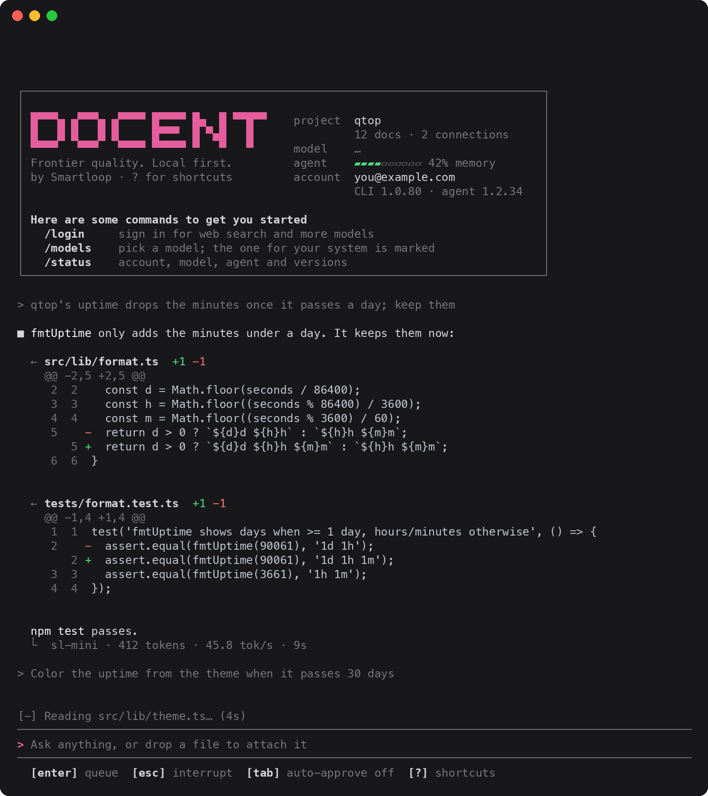

# Docent

The private code agent for your terminal. Frontier quality, local first.

Ask for a change and docent writes it: new files whole, changes to the files there as small edits, each shown as a diff as it streams and written as soon as it's done. Changes to files that are there ask first. Before it writes, it reads the current API of the libraries the change uses from their installed packages. It checks its work with your language servers (rust-analyzer, gopls, typescript-language-server, pyright, clangd), your build and your tests, hands any errors back to the model to fix, then runs the commands the reply gives, such as a commit, co-authored by docent. What you ask it to remember, it keeps for the project.

It's a document assistant too: chat with your PDFs and Office files, search the web, and connect MCP servers. If no local agent is running, the CLI downloads the framework and models it needs and starts one itself.



More at:
[docs.smartloop.ai](https://smartloop.ai/docs/intro/)

## Install

macOS and Linux

```sh
curl -fsSL https://smartloop.ai/install | sh
```

Windows (PowerShell):

```powershell
irm https://smartloop.ai/install.ps1 | iex
```

The binary goes to `$CARGO_HOME/bin` (`~/.cargo/bin`) when a Rust toolchain
already owns that directory, since it is on your `PATH` anyway; otherwise to
`~/.local/bin`. If the chosen directory is not on your `PATH`, the installer
appends an export line to the startup file for your shell — `~/.bashrc`,
`~/.zshrc`, or `fish_add_path` in `config.fish` — so a new terminal picks it up.
Re-running the installer will not add that line twice.

On Windows the binary goes to `%USERPROFILE%\.smartloop\bin` and the installer
sets your user `PATH` through the registry. Restart the shell to pick it up.

Set `SMARTLOOP_CLI_INSTALL_DIR` to install elsewhere, or `SMARTLOOP_CLI_VERSION`
to pin a specific release.

Prebuilt binaries are published for Linux (x86_64, aarch64; glibc, with the
Vulkan loader bundled), macOS (Apple Silicon, signed and notarized) and
Windows (x86_64, signed). The agent is built in, with GPU inference through
Metal on macOS and Vulkan on Linux and Windows.

On Linux the release folder goes to `~/.local/share/docent/<version>/`, and
the bin directory gets symlinks to it.

### From source

Requires Rust (2024 edition), CMake and a C/C++ toolchain, since the built-in
agent compiles llama.cpp. Pick the GPU backend with a feature:

```sh
cargo install --path . --features metal    # macOS
cargo install --path . --features vulkan   # Linux, Windows (needs the Vulkan SDK)
cargo install --path .                     # CPU only
```

The framework crate comes from Smartloop's public registry at
`https://dl.smartloop.ai/crates/`, declared in `.cargo/config.toml`; no
account or token is needed. `scripts/update-smartloop.sh [version]` moves it to
the newest (or given) release, and also picks up a version republished under
the same number; the **Update smartloop** workflow does the same on `main`
and can start a release after it.

## Quick start

All you need is `docent`. Run it and you're chatting: no account and no
separate agent setup.

```sh
docent
```

The first run downloads and starts the local agent for you (see
[First run](#first-run)). Everything below is optional:

- **AI search:** `/login` in the chat signs you in and enables web (AI) search.
- **Agent control:** `docent agent stop` stops the local agent and
  `docent agent start` starts it again.

## Usage

### First run

Any command that talks to the agent starts it when none is running. It
listens on a free port it picks itself and writes it to
`~/.smartloop/server.port`, where the CLI reads it. On first use that means:

1. Start the agent, which is built into the CLI (SLP framework 1.2.34), in
   the background with `SLP_HOME=~/.smartloop`, logging to
   `~/.smartloop/server.log`. An agent the chat started stops when it exits
   (unless another `docent` is still open); one started with
   `docent agent start` keeps running. An agent Studio desktop runs on the same home is used instead, when it is
   the same framework version.
2. Download the embedding model (`bge-m3-Q4_K_M.gguf`, ~417 MB) into the
   workspace's `models/embeddings/` folder for document search.
3. Run the agent's bootstrap, which downloads the decision model, creates
   the default project and loads the model.

Each step is skipped when its files are already there. Progress shows as a
checklist on stderr under the Docent banner that redraws in place, with
the active download's bar in Smartloop pink:

```
■ Start agent                    port 50578
■ Embeddings (bge-m3)                417 MB
■ Decision model sl-mini
  ██████████████▋░░░░░░░░░░░░░░░   49%  377 MB/769 MB
□ Default project
□ Load model
□ Skills and connections
```

A step without a bar shows its elapsed time once it runs past a couple of
seconds, and it ends with `✓ Setup complete in 1min 12s`.

When stderr isn't a terminal, each step prints one line as it finishes
instead. Enabling a model with `/models` shows the same checklist for its
download.

To do this up front, or to stop (and later restart) the agent. Optional; the
agent starts on its own when needed:

```sh
docent agent start
docent agent stop
```

### Login, projects and models

These live in the chat: `/login` signs in (optional; it unlocks AI search and
the models marked `(sign in)`), `/project` switches, creates, imports and
deletes projects, and `/models` enables and disables models. See the command
table under [the chat](#agent-status-and-chat).

### Agent status and chat

Check which endpoint the CLI uses, whether the local agent is running there,
which model it has loaded, and the per-project agents it has started:

```sh
docent agent status
```

```
Endpoint: http://localhost:50578
Status:   healthy
Model:    sl-mini (Q4_K_M, 32768 ctx, 769 MB)
Process:  pid 8738, 250 MB
+--------------+------+-------+-------+------+--------+
| Project      | PID  | Port  | Alive | Idle | Memory |
+--------------+------+-------+-------+------+--------+
| general_chat | 2668 | 62110 | true  | 94s  | 122 MB |
+--------------+------+-------+-------+------+--------+
```

`Endpoint` is the URL the CLI talks to (`SMARTLOOP_API_URL`, or the default).
The command exits with status 1 when the agent can't be reached there.

Start an interactive chat with the local agent:

```sh
docent
```

`docent` on its own is short for `docent run`. In a terminal this opens a full-screen app, laid out like Claude Code. While
a reply runs, a live status line above the prompt shows the agent's current
step (web search, document lookup, model selection) and for how long, with a
line per running download. Replies render as markdown, as in Claude Code:
headings, bold and italics, lists, quotes, syntax-highlighted code, and tables
drawn to fit the width. The finished reply keeps its sources and the model
that answered:

```
> what is the capital of France?

■ Paris is the capital of France.

  References
  [1] https://en.wikipedia.org/wiki/Paris
  ⎿  sl-mini · 7 tokens · 0.4 tok/s · 16s

[-] Reading en.wikipedia.org… (4s)
────────────────────────────────────────────────────────────────────────
> Ask anything, or drop a file to attach it
────────────────────────────────────────────────────────────────────────
  [enter] queue  [esc] interrupt  [tab] auto-approve off  [?] shortcuts
```

It chats in the server's current project, or the one given with `--project`.
On exit it prints the session id, to resume with `docent -s <session-id>` (or `--session`).

| Key | Does |
| --- | --- |
| `?` | shortcuts |
| `Enter` | send the prompt; while a reply runs, queue it to go once the reply and what follows are done |
| `Shift+Enter`, `Alt+Enter`, `Ctrl+J` | new line |
| `Esc` | interrupt the reply; the next queued prompt goes at once |
| `Esc` `Esc` | clear the prompt |
| `↑` with prompts queued | take back the last queued prompt to edit it |
| `↑` `↓` | earlier prompts, past the prompt's first or last line |
| `Enter`, `Tab`, `Esc` | a reply's commands, asked in the prompt: run, run and always this session, skip |
| `Tab` | on an empty prompt: auto-approve on or off, so a reply's commands run without asking |
| wheel, `PgUp`/`PgDn` | scroll; drag to select and copy |
| drop a file | attach an image (PNG, JPEG) or document (PDF, Office, CSV, text) |
| drop a `.zip` | on an empty prompt, fills in `/project import` for it |
| `Ctrl+O` | models: enable, disable, download |
| `Ctrl+P` | projects: switch (in a new session), create, delete |
| `Ctrl+B` | the commands still running (`/tasks`) |
| `Ctrl+C` | quit |
| `Ctrl+S` | web search on or off |

| Command | Does |
| --- | --- |
| `/login`, `/logout` | sign in with a code you confirm in any browser (`--token` to paste one) |
| `/models` | enable, disable and download models |
| `/models <name> caps <list\|auto>` | set a model's capabilities here, over the catalog's, as in `text,vision,reasoning`; `auto` goes back to the catalog's |
| `/models <name> thinking on\|off` | reasoning first, or a sooner answer (`Ctrl+T` in `/models`) |
| `/mcp` | MCP servers; `/mcp add <url>` connects one |
| `/project` | projects: switch (in a new session), create, import, delete |
| `/project <name>` | switch to a project by its name or ID |
| `/project new <name>` | create a project and switch to it |
| `/project import <zip>` | import an exported project and switch to it |
| `/status` | account, model, agent and versions |
| `/usage` | credits used this month (cloud models and web search) |
| `/upgrade` | Pro or Plus plan: more credits a month |
| `/clear` | clear the chat and start a new session |
| `/memory` | what docent was asked to remember in this folder; `/memory clear` forgets it |
| `/<skill> [prompt]` | run one of the project's skills; `/` lists them with the commands |
| `!<command>` | run a shell command in the working directory, its output shown as it comes, each command of a script on a `$` line over what it printed; the output goes to the agent with your next prompt, so it stays in the session. The prompt turns pink with `!` ahead as it's typed, and the footer says shell mode, as in Claude Code |
| `!<command> &` | run it in the background, as a dev server: nothing waits for it, and it's listed under the prompt, out of the chat, until it ends |
| `/tasks` | the commands still running, as in Claude Code: `↑` `↓` pick one, `Enter` shows all it printed, `x` stops it; `ctrl+b` opens it too (twice under tmux, where it's the prefix) |
| click a running command | its `✕ stop` in its entry stops it; a click on the command expands all it printed |
| `/help`, `/quit` | |

Pass an initial prompt to send immediately:

```sh
docent run "what are some things to do in madrid spain?"
```

Options:

```sh
docent run --project <project-id>   # chat in this project (-p)
docent run --session <session-id>   # resume an existing session (-s); a new one is created when omitted
```

`docent` runs in a terminal only: with its input or output piped, it says so
and stops.

### A folder and its project

A folder belongs to one project. Nothing in it is uploaded: the model reads
the code itself with its `explore` tool, as far as a request needs.

- Opening `docent` in a folder that isn't linked to a project yet gives it
  one of its own, named after the folder (a project by that name with no
  folder of its own is reused), and writes the link to
  `.docent/manifest.json`. Opening `docent` in a linked folder, or one under
  it, opens the chat in its project. `--project` opens another project
  instead, and links nothing.
- The folder is the nearest one up from where `docent` was opened that holds a
  `.docent/`, as git finds its repository. With none, it's the folder `docent`
  was opened in. Your home folder (or one holding it) is never linked.
- **Skills** are `.docent/skills/<name>.md` or `.docent/skills/<name>/SKILL.md`,
  with optional `name:` and `description:` frontmatter. They go to the project
  when the chat opens it and as soon as a reply writes one: new ones are
  added, changed ones updated, deleted ones removed. They are what you commit
  from `.docent/`; the manifest is kept out of git by `.docent/.gitignore`,
  as it names this machine's project.

### Coding

Open `docent` in a code project and just ask for a change. It reads the
folder, writes the code, builds it, fixes what breaks, and then asks before it
touches anything outside your files:

```
› make greet take a name and commit it

← src/main.rs  +2 −2
  @@ -1,4 +1,4 @@
   1  1  fn main() {
   2    -    greet();
      2 +    greet("docent");
   3  3  }
   4    -fn greet() { println!("hello"); }
      4 +fn greet(name: &str) { println!("hello, {name}"); }

! cargo check --quiet
  ✓ done

! cargo test --quiet
  ✓ done

? Run these in the folder?
  $ git commit -am "greet takes a name"
  [enter] run   [tab] always this session   [esc] skip
```

What happens on each prompt:

1. **It reads the project.** The agent is told what kind of project it is
   and its git state (branch, remotes, what's changed), and is given an
   `explore` tool. It calls it first for an overview of the codebase (its
   files with their sizes, manifests and README), then for the files, or
   the lines of a large one, that the request concerns, and decides from
   them what to do. Reading only reads, inside the folder, so it's never
   asked about. For what the code and the model's own knowledge don't
   tell, or may have out of date, it calls `web_search`, which searches
   through Smartloop's hosted search and reads the top pages. It's offered
   while the project's web search is on (ctrl+s), signed in. That way it
   answers from your code, and goes to the web only for what
   the code can't tell it, like a library's current API. It's also told about
   the machine (OS and version, shell, the package managers and toolchains on
   `PATH`, active virtualenvs), so commands use `apt-get` on Ubuntu and `brew`
   on a Mac. It's also told what you asked it to remember here (see below).
2. **It reads the current API.** The libraries the prompt names (three at
   most), or if it names none, the one whose package name has a word of the
   prompt in it that best fits what it asks ("yaml" for `js-yaml`, "MUI"
   for `@mui/material`), at the versions your lockfile pins, have their
   API read from the packages
   installed for the project: a crate's source in cargo's registry,
   `node_modules`' type declarations, the project's virtualenv, Go's module
   cache, or a Maven or Gradle jar. The parts the prompt uses
   go to the agent with it, so it doesn't write against an API it remembers
   from an older version. It's offline and costs nothing; a library that
   isn't installed yet goes without (building the project installs it), and
   with web search on (`Ctrl+S`) the agent can look it up itself. Each is
   kept in `.docent/cache/api/` as markdown you can read, which has a
   `.gitignore` of its own, so it's read once a version. `Esc` stops it.
3. **You see diffs as they stream in.** Each file shows as numbered hunks,
   additions in green and removals in red. Then it's written into the folder.
4. **It checks the build and fixes it.** It runs a fast check for the kind of
   project: `cargo check`, `go build`, `tsc --noEmit`, or `bash -n` and
   `py_compile` for loose scripts. Errors go back to the agent, round after
   round, until the check passes. It stops after five rounds, or sooner when
   a round brings back errors it had already given. `Esc` stops it.
5. **It runs the tests.** Once the change builds, the project's tests run:
   its end-to-end tests when it has them (an npm `test:e2e` or `e2e` script,
   a `make e2e` or `test-e2e` target), else `cargo test`, `go test`,
   `npm test`, `pytest`, `mix test`, `swift test`, `mvn test` or
   `./gradlew test`. Failures go back to the agent, three rounds at most.
6. **It remembers what you ask.** Say "remember we use pnpm" or "from now on,
   tabs" and it's kept in `.docent/memory.md`, one line each, and told to the
   agent in every later session in the folder. `/memory` lists it, and
   `/memory clear` forgets it; the file is yours to edit or commit.
7. **Commands wait for your OK.** Commits, installs and test runs come back
   as shell commands. `Enter` runs them, `Tab` runs them and approves every
   later one too, and `Esc` skips them. Their output streams into the chat and
   goes back to the agent, so a failing test gets fixed next.
8. **Long runs go to the background.** Dev servers and watchers (`npm run dev
   &`) keep running under the prompt while you go on chatting.

| Command | Does |
| --- | --- |
| `!<command> [&]` | run a shell command yourself, in the background with `&` |
| `/tasks` or `ctrl+b` | see, expand or stop running commands |
| `Tab` on an empty prompt | turn auto-approve on or off |

More in the [coding docs](https://smartloop.ai/docs/coding/).

## Configuration

The CLI connects to the local agent on whatever port it picked
(`~/.smartloop/server.port`). Point it elsewhere with `SMARTLOOP_API_URL`:

```sh
SMARTLOOP_API_URL=http://localhost:9000 docent agent status
```

With `SMARTLOOP_API_URL` set, the CLI only connects: it never installs or starts
an agent for that URL.

| Variable | Default | Effect |
| --- | --- | --- |
| `SLP_HOME` | `~/.smartloop` | Where the workspace, models and logs live |
| `SLP_PORT` | a free port | Pin the managed local agent to this port |

## License

Released under the [MIT License](LICENSE).
